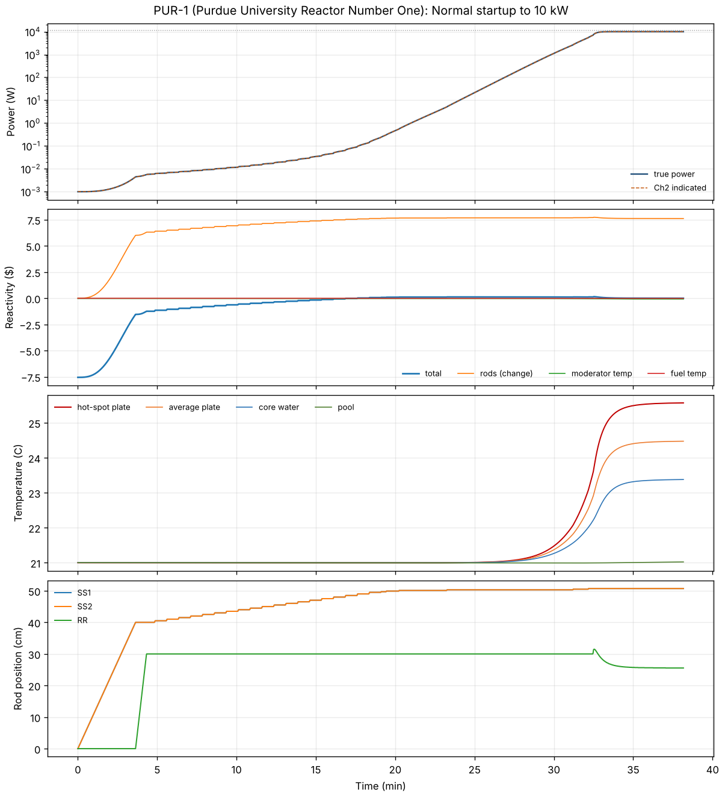
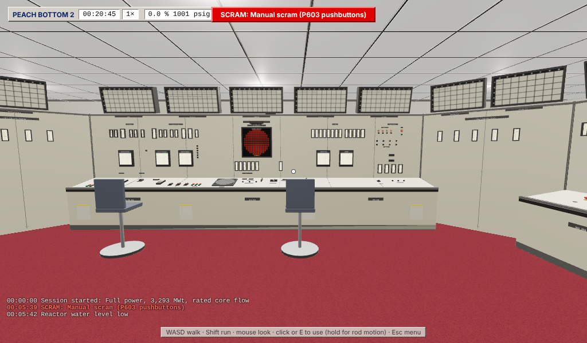
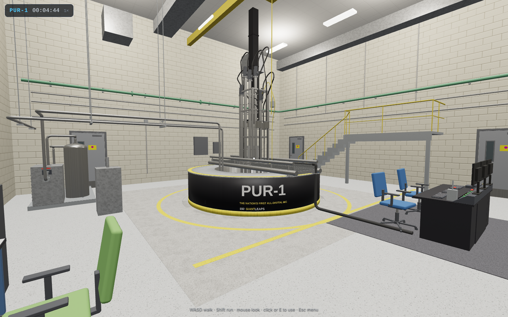
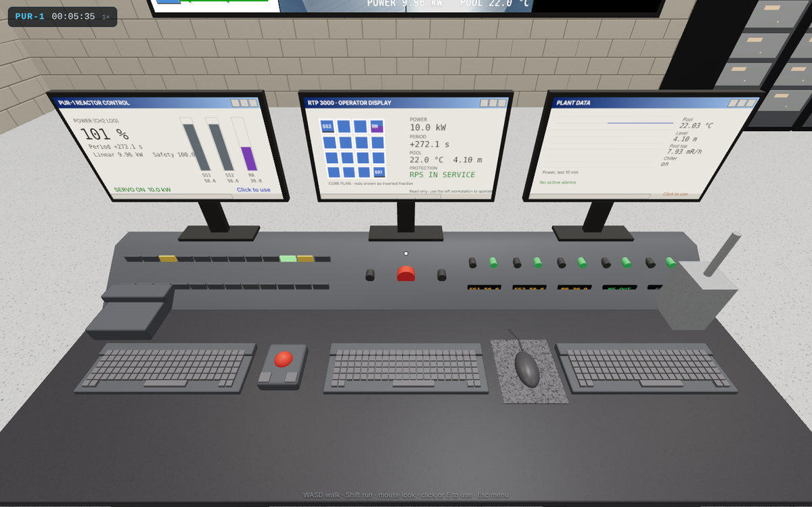
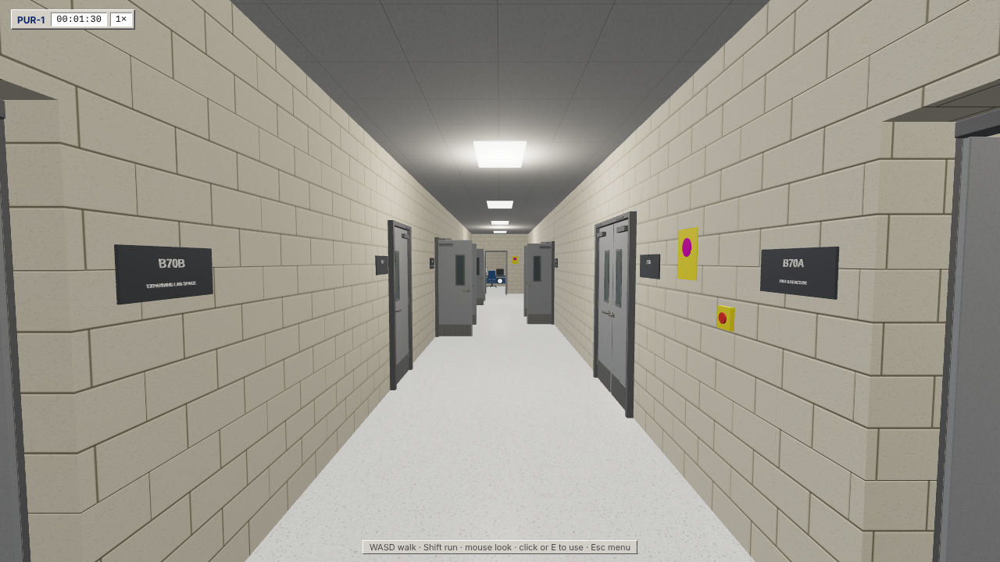
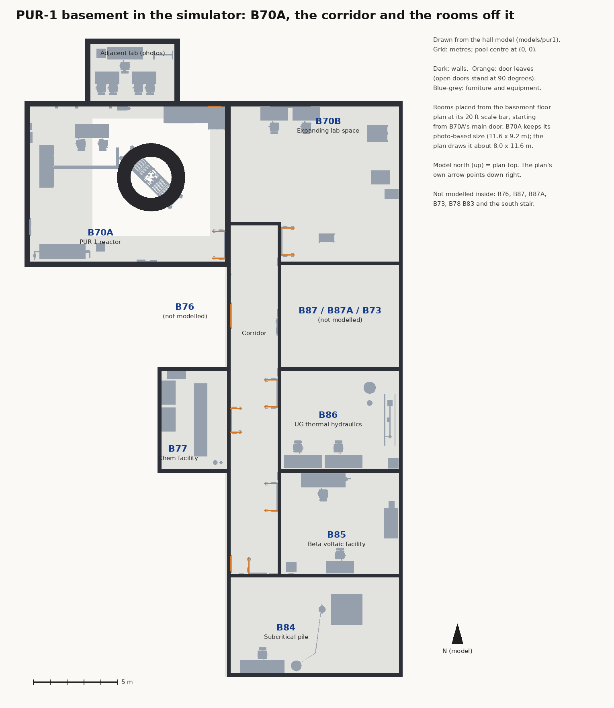
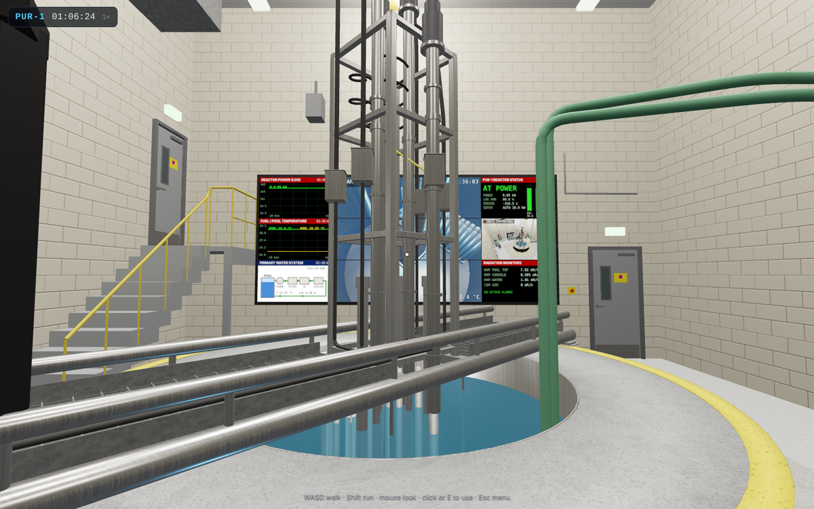
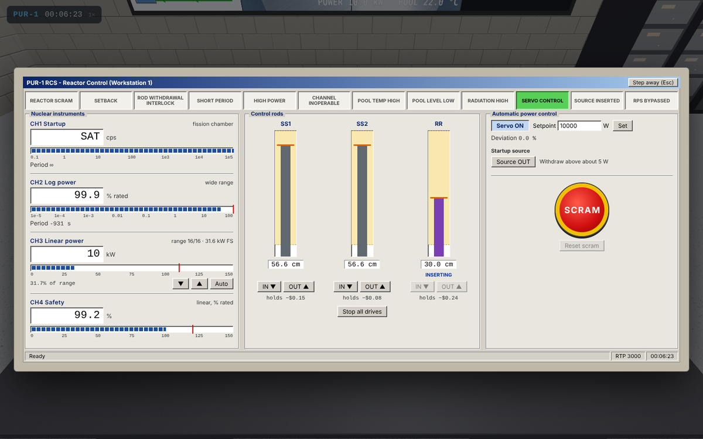
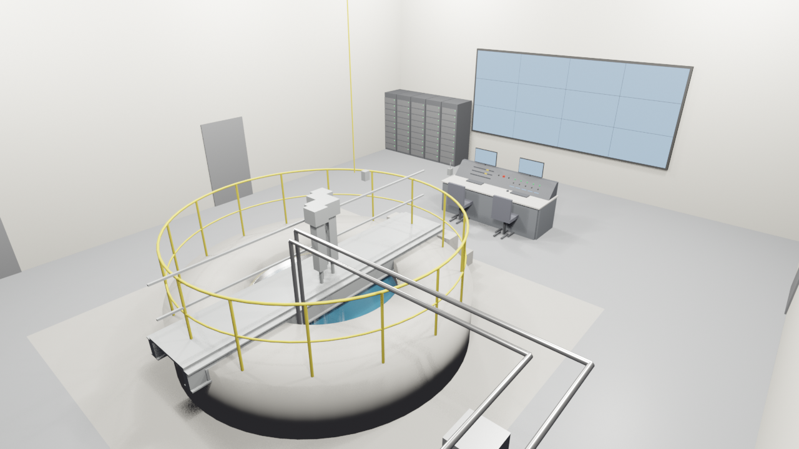

# NPSS

**NPSS** (Nuclear Power Plant Simulator Suite) is a physics-first nuclear reactor simulator.
Its Python package is `reactorsim`. It is built to be a credible engineering
model first and a control-room experience second, and it is designed to grow from
one reactor to many.

The first reactor is **PUR-1**, Purdue University's 10 kW pool research reactor
and the first US reactor licensed with an all-digital safety and control system.
It is the test bed: a small, well-documented core whose digital controls can be modeled one-for-one.

The second is **Peach Bottom Unit 2**, a General Electric BWR/4 in a Mark I containment,
modelled as it ran the 1977 turbine trip tests that became the OECD/NEA BWR Turbine Trip
benchmark. See [Peach Bottom 2](#peach-bottom-2-bwr4) below.



## What it models

| Area | Model |
| --- | --- |
| Neutron kinetics | Point kinetics, PUR-1's own 6 delayed groups, Pu-Be startup source; advanced exactly with a matrix exponential, so prompt-critical bursts are stable and accurate |
| Feedback | Fuel (Doppler), moderator temperature, and void from subcooled and bulk boiling |
| Thermal hydraulics | Fuel plates, core channel water and pool as heat-capacity nodes; natural circulation; boiling curve with critical heat flux and film boiling; chiller with thermostat; pool draining below the core |
| Poisons and fuel | I-135/Xe-135 and Pm-149/Sm-149 chains; U-235 depletion; 17-group decay heat |
| Control rods | S-shaped worth curves, motor drive speeds, electromagnet gravity scram, re-latching after a scram, stuck and runaway drive faults |
| Instruments | PUR-1's four neutron channels (startup fission chamber, log-N, linear with 16 ranges, safety), period meters, counting noise, radiation monitors; fault modes: fail low/high, stuck, gain error, drift, HV loss |
| Protection and control | Scrams, gang-lower setbacks, withdrawal interlocks (including one rod at a time) at PUR-1's setpoints; regulating-rod power servo; failed-trip and failed-RPS modes for licensing and beyond-design accidents |
| Consequences | Fuel safety limit, cladding blistering and melting, fission-product release into the pool, dose rates as shielding water is lost |

Every PUR-1 number, where it came from, and which ones are still assumptions are in
[docs/pur1_reference.md](docs/pur1_reference.md). The values follow the project's PUR-1
Simulator Parameter Sheet (SAR 2008/2015, Technical Specifications, digital twin paper).

## Quick start

```bash
pip install -e .[dev]
python -m reactorsim list
python -m reactorsim run startup --plot startup.png
python -m reactorsim experiments
python -m pytest            # validation tests
```

```python
from reactorsim import Simulator

sim = Simulator("pur1")
sim.initialize_at_power(10_000)          # critical at 10 kW
sim.set_servo(True, 10_000)
sim.insert_reactivity(0.003)             # an experiment at the tech-spec limit
sim.run(60)
print(sim.status()["scram_causes"])      # period and power scrams
```

## Peach Bottom 2 (BWR/4)

`reactorsim.bwr.BWRSimulator` wraps the same kinetics, poison, decay-heat and burnup models in
a lumped BWR plant: a fuel node conducting to boiling coolant, inlet subcooling and a core void
that lags its steady value, one dome pressure buffered by the steam space and the saturated
liquid, two recirculation pumps on jet pumps plus natural circulation, main steam lines with
MSIVs, a pressure regulator on the turbine control valves, 25% bypass and eleven safety/relief
valves to the torus, three-element feedwater level control, HPCI, RCIC, core spray, LPCI and
ADS at their level and pressure permissives, and the reactor protection system (APRM fixed and
flow-biased, high pressure, Level 3, stop-valve and MSIV closure) with the ATWS pump trip.

```bash
python -m reactorsim run pb2_turbine_trip_benchmark      # the 1977 TT2 test
python -m reactorsim run pb2_station_blackout --plot sbo.png
```

```python
from reactorsim import simulator_for

sim = simulator_for("peach_bottom_2")
sim.initialize_at_power(3293e6)          # steady at rated power, rods at the critical notch
sim.trip_feedwater()
sim.run(600)
print(sim.status()["level_in"], sim.hpci.running)
```

The control-room app has the Peach Bottom main control room too (`Peach Bottom 2 control room`
on the main menu, or `/pb2.html`): the Unit 2 horseshoe of GE benchboards in its analog state,
with the reactor control benchboard (P603: full core display, APRM/IRM/SRM meters, rod select
matrix and rod pushbuttons, mode switch, manual scram buttons, recirculation and feedwater
stations), the core cooling benchboard (P601: HPCI, RCIC, core spray and RHR switches, the
eleven SRV switches, ADS, MSIVs) and the turbine-generator benchboard (P653), with annunciator
windows above each. Every meter, recorder, lamp and switch is driven by `BWRSimulator` through
`reactorsim/app/bwr_session.py`; the faces are drawn live from the plant readings in the units
engraved on the panels (psig, inches, Mlb/h, gpm, degrees F).



Every number, where it came from and which are still typical-BWR/4 stand-ins are in
[docs/peach_bottom_2_reference.md](docs/peach_bottom_2_reference.md). The control-room
application is still PUR-1 only; the Peach Bottom plant and rooms come next.

## Reactor physics experiments

The classic research-reactor lab measurements, run on the simulated PUR-1 the way a student
crew would run them at the console. Each one uses only what the instruments show (count rates,
log and linear power, rod positions, pool temperature, all with their noise) and reports the
measured value next to the value built into the model, so the technique itself can be judged.

| Experiment | Method | Typical result (seed 1) |
| --- | --- | --- |
| `approach_to_critical` | 1/M plot with the source in, shims withdrawn as a bank, each step at most halfway to the prediction | Critical bank 55.98 cm against 56.11 cm |
| `rod_calibration` | Positive period: step the regulating rod, fit the stable period, inhour equation, return to power with a shim | RR worth $0.347 against $0.344 (+0.6%) |
| `rod_drop` | Drop SS2 alone; inverse kinetics, integral count and prompt jump; rod-bottom time | $2.735 by inverse kinetics; integral count 5% low, prompt jump 29% high; drop 0.56 s |
| `sample_worth` | Servo holds 1 W while an absorber sample goes in; worth from the RR curve | -$0.0998 against -$0.100 |
| `temperature_coefficient` | Servo finds the critical RR position at four pool temperatures | -1.256 cents/C against -1.257 |
| `power_calibration` | Pool heat-up rate with the chiller off, less the shut-down drift, times the pool's heat capacity | 9.90 kW against 9.91 kW thermal; catches miscalibrated channels |

```bash
python -m reactorsim experiment rod_calibration --plot rr.png --json rr.json
python -m reactorsim experiment power_calibration --no-noise
```

```python
from reactorsim.experiments import EXPERIMENTS

sim, cal = EXPERIMENTS["rod_calibration"].run()
sim, s = EXPERIMENTS["sample_worth"].run(sample_dollars=-0.2, calibration=cal["integral_curve"])
```

The analysis tools (`fit_period`, `inhour_reactivity`, `inverse_kinetics`) are in
`reactorsim/experiments.py` for building new experiments.

## Materials science lab

The adjoining lab (the diagnostics bench and the lab tables in the hall, or **Materials lab** in
the menu) is a working irradiation facility. Prepare samples, lower them into the in-core centre,
core edge, reflector or pool positions, run the reactor, then pull them out and count them on the
HPGe gamma spectrometer. Every sample is worth a little negative reactivity while it is in, so the
console feels it.

The physics is modelled from the ground up: (n,gamma) capture with thermal cross sections and
resonance integrals, fast (n,p) threshold reactions, exact build-up and decay of each product,
a 4096-channel detector with real efficiency, resolution, Compton continuum, room background,
dead time and counting statistics. The analysis software does a peak search, identifies
nuclides from their lines and works back to the activity at the end of irradiation. The screen
walks through five guided experiments:

| Experiment | What you do | Typical result (seed 1) |
| --- | --- | --- |
| `foil_activation` | Bare and cadmium-covered gold foils give thermal and epithermal flux and the cadmium ratio | 2.208e10 n/cm2-s per kW, within 0.1% |
| `activation_analysis` | Identify and quantify the elements in an unknown sample (absolute-method NAA) | Al, Na, K, Cl, Mn found, all within 5% |
| `half_life` | Repeated counts of an indium foil, fit the decay of In-116m | 3263 s against 3257 s |
| `silicon_doping` | Neutron transmutation doping of a silicon wafer to a target resistivity | 1992 ohm-cm against a 2000 target |
| `radiation_damage` | Fast flux from Ni-58(n,p)Co-58 in stainless steel, displacements per atom and hardening | Fast flux within 0.4% |

```bash
python -m reactorsim experiment activation_analysis
```

## Control room (Mac app)



You are an operator standing in the PUR-1 reactor hall, modelled on the real room: painted
block walls, the round black pool wall with the PUR-1 graphic and its yellow safety rim, the
bridge running northwest to southeast over the water with its grating, drive cage and tall
stainless drive tubes trailing black cable bundles up to the cable gantry, the purification and
cooling skid in the southwest corner, the stair along the north wall up to the northeast
platform, the video wall on the east wall, and the adjoining lab with the diagnostics bench and
its green chair. The room follows the PUR-1 layout map: the desk console with three monitors
and blue chairs stands northwest of the pool with the operator facing north, the black digital
I&C cabinets with their red LED readouts are on the operator's left along the west wall, and the
video wall is on the right. Walk around it in first person
(WASD, Shift to run, mouse to look), climb the stair for a view down into the pool, and operate
the reactor from the console:

The workstations, the menu and every other window look like the plant's own late-1990s operator displays: grey window chrome,
navy title bars, etched group boxes and white value fields.

- **Workstation 1, reactor control** (left-hand monitor): the four neutron channels, rod
  drives you hold to move or send to a set point (type a position in cm and press Go; the drive
  runs there and stops, one rod withdrawing at a time), linear-channel ranging, the servo, the startup source, scram and
  reset, and the annunciators.
- **Workstation 2, plant data** (right-hand monitor): the power history, a core camera, pool and
  radiation readings, reactivity and the event log.
- **RTP 3000 operator display** (centre monitor): a read-only core mimic with the rod
  positions, power, period, pool and protection status.
- **Hard-wired controls** on the console: hold a rod drive's UP or DOWN button to move it,
  the red manual scram button, the magnet power switch (scram) and the master key switch
  (scram reset), plus NS buttons for the startup source. The hallway scram button in the
  corridor just outside the main door works too.



### The basement

The main door stands open onto the basement corridor, laid out from the PUR-1 basement floor
plan, and the rooms off it can be walked into:

| Room | What is in it |
| --- | --- |
| B70B, expanding lab space | Open floor east of the reactor room: the first two benches, an empty equipment rack, crated equipment and taped outlines for the next benches |
| B86, undergraduate thermal-hydraulics lab | A natural-circulation water loop on a strut frame (heated glass test section, cooler, expansion tank), reservoir, pump, heater supply and student DAQ benches |
| B85, beta-voltaic facility | Glovebox, light-tight probe station with source-measure units, lead source safe |
| B77, chemistry facility room | Two fume hoods, an epoxy-top island bench with reagent shelf and sink, flammables cabinet, safety shower |
| B84, subcritical pile | The graphite pile (172.7 x 172.7 x 203.2 cm) with its fuel channels and testbed, the Pu-Be source cask, a BF3 counter and the counting bench |

Each room has its number plate by the door, and pointing at the equipment names it. B76, B87
and the south stair have closed doors. The reactor room keeps the size it was given from the
photos (11.6 m by 9.2 m); the plan draws it about 8.0 m by 11.6 m, so the other rooms are placed
from the main door at the plan's scale.





The monitors in the hall are copies of the two workstation screens, so whatever is entered at a
workstation (rod set points, the servo set point, the linear range, the source, the trend window)
shows on them too. The monitors, rod position readouts and annunciator lamps show the live plant, and the blades
in the core move with the rods. The video wall is laid out like the real one: power and
temperature trends down the left over a white plant schematic, a live underwater camera on the
core across the middle, and the reactor status, a hall camera and the radiation monitors down
the right.



Esc leaves a workstation or opens the menu, and never takes the app out of full screen; F (or
**Full screen** in the menu) switches full screen on and off. On a Mac the walk keys and the
mouse do not set off the system alert sound. The menu has the simulation
speed (1x to 100x), restart, true plant values and the instructor station, which injects
experiments, rod and instrument faults, a chiller trip, a pool leak and protection failures.



**Install the app.** Every merge to `main` that touches the simulator builds
`NPSS.app` for Apple silicon and publishes it on the repository's
[Releases](../../releases) page as `NPSS-macOS.zip`. (Apps installed when it was still called PUR-1 Simulator
update themselves to NPSS and are renamed on the way.)

1. Download the zip from the latest release, unzip it and drag the app to Applications.
2. The app is not signed with an Apple developer certificate, so macOS blocks the first
   launch. Open it once, then go to System Settings > Privacy & Security and click
   **Open Anyway** (or run `xattr -dr com.apple.quarantine "/Applications/NPSS.app"`).
3. That is all: the repository is public, so the app needs no token to see new builds. (The
   **Updates** dialog still accepts an optional GitHub token, which raises the API rate limit
   and keeps updates working if the repository is ever made private; it is stored only on
   that Mac.)

From then on the app checks for a newer build when it opens, and **Install and restart**
downloads it, swaps it in place and relaunches.

**Run it from source** (any OS):

```bash
pip install -e .[app]        # pywebview gives it its own window; without it, it opens in the browser
python -m reactorsim app     # or: python -m reactorsim app --browser --initial power_10kw
```

Build the app yourself on a Mac with `pip install ".[mac]"`,
`python packaging/macos/make_icon.py` and `pyinstaller packaging/macos/npss.spec`.

## 3D models

Scripted Blender (`bpy`) models of the PUR-1 reactor hall, core and console area, and of the
Peach Bottom Unit 2 main control room (`models/peach_bottom`), exported as glTF for the
control-room interface, live in [models/](models/README.md).



## Scenarios

| Scenario | What happens |
| --- | --- |
| `startup` | Cold shutdown to 10 kW following the startup procedure, one rod at a time (about 37 minutes) |
| `scram` | Scram from 10 kW: prompt drop, then the stable negative period (about -75 s) |
| `xenon` | 40 h at power, then shutdown; shows why xenon barely matters at 10 kW |
| `experiment` | A 0.003 dk/k experiment inserted at full power |
| `rod_withdrawal` / `rod_withdrawal_atws` | A shim drive runs away, with and without protection |
| `reactivity_accident` / `reactivity_accident_large` | Hypothetical $1.50 and $4.00 step insertions with the RPS failed |
| `loss_of_chiller` | Pool heats about 0.33 C/h at 10 kW; temperature alarm after about 24 h |
| `loss_of_pool_water` | A pool leak: radiation monitors scram the reactor, then the core is uncovered |
| `calibration_error` | Recreates the 2019-2020 event where new instruments read 3x low |
| `linear_channel_failure` | The servo's channel reads half of true power; the safety channel has to catch the rise |
| `sar_step_scram`, `sar_ramp_scram`, `sar_step_no_scram` | The licensing-basis 0.6% dk/k insertions from the SAR, for benchmarking |

## Validation so far

| Check | Reference | Simulator |
| --- | --- | --- |
| Period after scram | -1/lambda_1 = -75 s for PUR-1's group data | -75 s |
| Stable periods for step insertions | inhour equation | within 2% |
| Prompt jump | beta / (beta - rho) | within 3% |
| Banked critical rod height | about 53.5 cm (SAR 2008) | 53.9 cm |
| Shutdown margin | 0.018 measured | 0.018 |
| 0.6% step from 12 kW, scram at 18 kW actual | 46.4 kW at 0.173 s (SAR, PARET) | 55 kW at 0.172 s |
| 0.6% over 10 s from 12 kW | 18.4 kW (SAR, PARET) | 18.4 kW |
| Hot clad at 18 kW | about 43 C (SAR, NATCON) | 44.7 C |
| Pool heat-up without chiller at 10 kW | about 0.36 C/h | 0.33 C/h |
| Instruments reading 3x low | 2019-2020 event: above 12 kW whenever indicated passed about 4 kW | 30 kW true at 10 kW indicated |
| Fuel damage threshold, no scram | SPERT-I plate core: no damage around $1.5, melting at $3.3 | none at $1.50, blistering from about $2.5, melting at $3.3 |

Remaining gaps against the licensing analyses are listed in
[docs/pur1_reference.md](docs/pur1_reference.md#benchmarks-against-the-licensing-analyses).

## Layout

```
reactorsim/
  physics/     kinetics, thermal, poisons, burnup, decay heat (reactor independent)
  plant/       rods, instruments, radiation, protection, servo
  reactors/    one module per reactor design (pur1.py)
  simulator.py the control loop and operator actions
  scenarios.py scripted operations and accidents
  experiments.py reactor physics and materials lab experiments and their analysis tools
  materials.py   materials lab: activation, sample positions, HPGe detector and analysis
  app/         control room: live session, local server, web page, updater
packaging/     Mac app build (PyInstaller)
tests/         validation tests
docs/          reference data and plots
```

Adding a reactor means writing one `ReactorDesign` in `reactorsim/reactors/`. Larger
power reactors will need a spatial core model and a primary loop, which slot in
beside the current lumped models.

## Roadmap

1. PUR-1 reference data (done; open questions in the reference doc)
2. Core physics engine with validation (this release)
3. Control system detail and a fuller accident set
4. Control-room operator interface on top of the engine (first version: the Mac app)
